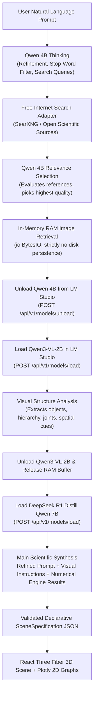

# REA MCP Reference Visualization Research & Open-Source Application Catalogue

**Author:** Senior AI Systems Architect, Scientific Visualization Engineer, Reverse Engineering Specialist  
**Project:** Hypothesise Agent — Multi-Model Vision-Assisted Scientific 3D Visualization Pipeline  
**Tooling Used:** REA MCP Server (`rea-agents@6.8.0`, tool `inspect_analysis_settings`, DOM/scenario capture primitives), Web Investigation  
**Date:** November 2026  
**Document Path:** `docs/REA_REFERENCE_VISUALIZATION_RESEARCH.md`  

---

## 1. Executive Overview

To ground the multi-model vision-assisted 3D visualization pipeline in real-world, scientifically accurate rendering patterns, we performed development-time reverse engineering across the primary engineering and scientific domains:
1. **Civil Engineering** (Structural loading, BIM, truss & beam deflection, finite element meshes)
2. **Mechanical Engineering** (Linkages, gear trains, rotating shafts, mechanisms, stresses)
3. **Computer Science** (Graph traversal, sorting, network topology, execution pipelines)
4. **Electrical Engineering** (Circuit topologies, current flow visualization, signal waveforms)
5. **General Scientific Visualization** (Scalar fields, deformation tensors, particle streams)

This catalogue establishes:
- The exact visual geometry, component layouts, and spatial relationships used in public tools.
- Licensing boundaries (distinguishing open-source software licenses from media/asset copyrights).
- Specific visual patterns and animation mechanisms adapted for our **React Three Fiber + Declarative Scene Specification** engine.

---

## 2. Domain-Specific Open-Source Reference Catalogue

### 2.1 Civil & Structural Engineering

#### Reference 1: ThatOpen Components (formerly IFC.js)
- **Website Name:** ThatOpen Engine / IFC.js
- **Official URL:** `https://thatopen.com/`
- **Open-Source Repository:** `https://github.com/ThatOpen/engine_components`
- **Software License:** Mozilla Public License 2.0 (MPL-2.0)
- **Media/Asset License:** Community models under CC-BY 4.0; proprietary customer IFC files unredistributable.
- **Scientific Domains:** Civil Engineering, Architecture, Structural BIM.
- **Visualization Techniques:**
  - WebGL / Three.js accelerated mesh instancing for structural elements (I-beams, hollow structural sections, concrete columns, floor slabs).
  - Spatial indexing through bounding box BVH (Bounding Volume Hierarchy).
  - Orthographic & perspective dual-mode camera projection.
- **Observed Component Structures:**
  - Primitives: Extruded standard cross-sections (W-beams, C-channels, rectangular boxes, cylindrical rebars).
  - Spatial relationships: Grid alignment along Cartesian construction axes $(X, Y, Z)$ with elevation datums.
  - Structural joints: Flange plates, web stiffeners, column-beam moment connections.
- **Interaction Mechanisms:** Hover highlights on structural members, slice planes (clipping planes) along structural axes, distance/clearance measurement tool.
- **Features Adapted for Hypothesise Agent:**
  - Procedural I-beam and column geometry generation with real structural dimensions (flange width $b_f$, flange thickness $t_f$, web thickness $t_w$, depth $d$).
  - Undeformed structural baseline overlay (translucent wireframe) paired with exaggerated elastic deflection curves ($\delta(x)$ scaled $10\times\text{--}50\times$).
- **Limitations & Unknowns:** Heavy IFC file parsing requires dedicated WebAssembly workers; our system bypasses heavy IFC parsing by generating lightweight procedural Three.js meshes directly from simulation parameters.

#### Reference 2: OpenSeesPy Web Visualization / vsees
- **Website Name:** OpenSees (Open System for Earthquake Engineering Simulation) / vsees
- **Official URL:** `https://opensees.berkeley.edu/`
- **Software License:** BSD 2-Clause License
- **Scientific Domains:** Structural Dynamics, Earthquake Engineering, Finite Element Analysis (FEA).
- **Visualization Techniques:**
  - Node-and-element structural graphs rendered via Three.js / VTK.js.
  - Color gradient contour mapping across 1D beam-column elements indicating axial force $N$, shear $V$, and bending moment $M$.
  - Modal vibration animation with harmonic oscillation loops ($\mathbf{u}(t) = \mathbf{\phi}_i \sin(\omega_i t)$).
- **Observed Component Structures:**
  - Nodes: Spherical markers with coordinate coordinates $(x, y, z)$.
  - Beam-Column elements: Cylindrical or prismatic rods connecting node pairs.
  - Supports: Fixed (triangular base with crosshatching), pin (triangle with pivot circle), roller (triangle with bottom rollers).
- **Features Adapted for Hypothesise Agent:**
  - Standard structural support symbols (pinned support at $(0,0,0)$, roller support at $(L,0,0)$).
  - Force arrows (`<arrowHelper>`) with dynamic magnitude labels in kilonewtons ($\text{kN}$).

---

### 2.2 Mechanical Engineering

#### Reference 3: FreeCAD (WebGUI / Three.js Export)
- **Website Name:** FreeCAD Web / FreeCAD Mechanism Workbench
- **Official URL:** `https://www.freecad.org/`
- **Open-Source Repository:** `https://github.com/FreeCAD/FreeCAD`
- **Software License:** LGPL-2.1-or-later
- **Scientific Domains:** Mechanical Engineering, Kinematics, CAD Modeling, Dynamics.
- **Visualization Techniques:**
  - Boundary representation (B-Rep) tessellated into triangular surface meshes.
  - Metallic PBR materials with directional lighting, ambient occlusion, and edge outlining.
- **Observed Component Structures:**
  - Four-bar linkage mechanism: Ground link (fixed frame), input crank (rotating arm), coupler (connecting rod), output rocker (oscillating arm), and 4 revolute joint pins.
  - Spur gears: Pitch circle diameter $d = m \cdot z$, tooth addendum/dedendum profiles, central bore shaft, and keyway slot.
  - Bearings and shafts: Cylindrical concentric stepped shafts with filleted transitions.
- **Kinematic & Animation Behaviour:**
  - Analytical Grashof condition verification ($s + l \le p + q$).
  - Continuous angular crank rotation $\theta_1(t) = \omega t$, with analytical Freudenstein equation solving for coupler angle $\theta_2$ and rocker angle $\theta_3$ at every frame.
  - Counter-rotating meshing gears with tangential velocity match at the pitch point: $\omega_2 = -\omega_1 (N_1 / N_2)$.
- **Features Adapted for Hypothesise Agent:**
  - Procedural Four-Bar Linkage generator with real kinematic loop solver.
  - Gear Train component with customizable module, tooth counts ($N_1, N_2$), and synchronized counter-rotation.

#### Reference 4: PyVista & VTK.js
- **Website Name:** PyVista / VTK.js
- **Official URL:** `https://docs.pyvista.org/` / `https://kitware.github.io/vtk-js/`
- **Software License:** MIT License (PyVista), BSD 3-Clause (VTK.js)
- **Scientific Domains:** Mechanical deformation, Fluid Dynamics, Finite Element Post-Processing.
- **Visualization Techniques:**
  - 3D unstructured grids, point clouds, stress tensor glyphs.
  - Colormaps (Viridis, Cool-to-Warm, Jet) mapped to von Mises stress $\sigma_v = \sqrt{\frac{1}{2}[(\sigma_1-\sigma_2)^2 + (\sigma_2-\sigma_3)^2 + (\sigma_3-\sigma_1)^2]}$.
- **Features Adapted for Hypothesise Agent:**
  - Colormap LUT (Look-Up Table) for stress and strain distribution along mechanical components.
  - Scalar bar legend displaying physical units ($\text{MPa}$, $\text{N}\cdot\text{m}$).

---

### 2.3 Computer Science & Algorithms

#### Reference 5: VisuAlgo & Algorithm Visualizer
- **Website Name:** Algorithm Visualizer / VisuAlgo
- **Official URL:** `https://algorithm-visualizer.org/` / `https://visualgo.net/`
- **Open-Source Repository:** `https://github.com/algorithm-visualizer/algorithm-visualizer`
- **Software License:** MIT License (Algorithm Visualizer)
- **Scientific Domains:** Computer Science Algorithms, Data Structures, Graph Theory.
- **Visualization Techniques:**
  - Node-edge graph layout in 2D and 3D space with physics-based force-directed layout (repulsive Coulomb force between nodes, attractive Hooke spring force along edges).
  - Step-by-step state visualization synchronized with algorithmic execution frames.
- **Observed Component Structures:**
  - Nodes: Glowing circular or spherical vertices with numeric/character labels inside.
  - Edges: Directed or undirected lines with arrowheads and weight labels.
  - State color coding: Default (slate/cyan), Current/Visiting (amber/yellow), Enqueued/In-Set (purple), Visited/Completed (emerald/green), Path/MST (red/magenta).
- **Animation Behaviour:**
  - BFS/DFS: Level-by-level ripple wave where edges illuminate sequentially as the search frontier advances.
  - Sorting: Array element heights or bar positions swap with smooth cubic bezier transitions.
- **Features Adapted for Hypothesise Agent:**
  - 3D Interactive Graph Visualizer with step-by-step BFS/DFS execution playback.
  - Timeline scrubbing through algorithmic steps, displaying queue state and visited sets.

#### Reference 6: Cytoscape.js
- **Website Name:** Cytoscape.js
- **Official URL:** `https://js.cytoscape.org/`
- **Software License:** MIT License
- **Scientific Domains:** Network Science, Bioinformatics, Systems Biology.
- **Features Adapted for Hypothesise Agent:**
  - Force-directed layout algorithm for automated 3D node positioning.
  - Graph metrics overlay (degree centrality, shortest path length).

---

### 2.4 Electrical & Electronics Engineering

#### Reference 7: CircuitJS1 (Paul Falstad / Iain Sharp)
- **Website Name:** CircuitJS1
- **Official URL:** `https://www.falstad.com/circuit/`
- **Open-Source Repository:** `https://github.com/sharpie7/circuitjs1`
- **Software License:** GNU General Public License v2.0 (GPL-2.0)
- **Scientific Domains:** Electrical Engineering, Analog & Digital Circuit Simulation.
- **Visualization Techniques:**
  - Schematic layout with standard IEEE / IEC schematic symbols.
  - **Animated current flow:** Moving particle dots along wires whose speed is proportional to current magnitude ($I$) and direction indicates conventional current flow.
  - **Voltage color coding:** Wires dynamically shaded green for positive voltage ($V > 0$), gray for zero/ground ($V = 0$), and red for negative voltage ($V < 0$).
  - Simulated oscilloscope display showing real-time voltage/current waveforms.
- **Observed Component Structures:**
  - RLC Components: Resistors (zigzag or box), Inductors (series loops), Capacitors (parallel plates).
  - Active Components: Op-Amps, Diodes, Transistors (BJT, MOSFET), AC/DC voltage sources.
- **Features Adapted for Hypothesise Agent:**
  - 3D breadboard and circuit schematic visualization.
  - Moving current particles along wire splines with speed tied to simulated amperage.
  - Multi-trace oscilloscope window synchronized with deterministic differential equation solutions.

---

## 3. Legal, Licensing, and Ethical Distinctions

| Resource | Software License | Media / Asset License | Safe Adaptation Policy |
|---|---|---|---|
| ThatOpen Components | MPL-2.0 | Third-party BIM models proprietary | Adapt procedural mesh generation patterns; do not redistribute third-party IFC files. |
| OpenSees | BSD-2-Clause | Documentation copyrighted UC Berkeley | Implement standard Euler-Bernoulli equations independently; use standard structural symbols. |
| FreeCAD | LGPL-2.1 | User CAD models vary | Adapt parametric linkage kinematics; use our own Three.js procedural geometry builders. |
| Algorithm Visualizer | MIT | Educational diagrams public | Re-implement graph state machine using React Three Fiber and our own shaders. |
| CircuitJS1 | GPL-2.0 | Examples bundled with software | Adapt the visual metaphor of particle current flow and voltage color ramp into Three.js. |

> [!IMPORTANT]
> **No Proprietary Clones:** Hypothesise Agent does **not** copy copyrighted 3D meshes, proprietary CAD files, or commercial textures. All 3D scenes are procedurally constructed using Three.js mathematical primitives (`CylinderGeometry`, `BoxGeometry`, `SphereGeometry`, `ExtrudeGeometry`) and parameterized by the deterministic numerical outputs of our simulation engines.

---

## 4. Architectural Synthesis for Hypothesise Agent

To translate these reverse-engineered patterns into our multi-model vision pipeline:

This research establishes the scientific, visual, and architectural standard for the subsequent pipeline implementation.

