# HYPOTHESISE AGENT — UI SYNCHRONIZATION ARCHITECTURE IMPLEMENTATION
**Generated:** 2026-11-19  
**System:** Bohr Agent SDK / Hypothesise Agent v4.2  
**Core Principle:** ONE EXPERIMENT RUN → ONE AUTHORITATIVE DATA SOURCE → SYNCHRONIZED UI COMPONENTS → VERIFIED DISPLAYED VALUES  

---

## 1. Architectural Overview

The Hypothesise Agent platform features a decoupled React 18 frontend communicating with a FastAPI backend, deterministic domain multi-physics engines, and a sequential local model manager (LM Studio port 1234).

To resolve state synchronization failures, hardcoded telemetry, and inert parameter controls, a centralized data synchronization architecture has been implemented.

```mermaid
flowchart TD
    subgraph UI_Layer ["React 18 User Interface"]
        Sidebar["Sidebar.jsx (Telemetry & Ping)"]
        TopBar["TopBar.jsx (Health & DataFreshness)"]
        ExpComposer["ExperimentComposer.jsx (Formulation)"]
        SimWorkspace["SimulationWorkspace.jsx (3D & 2D Curves)"]
        ValPanel["ScientificValidationPanel.jsx (Audit Proofs)"]
        ModelStatus["ModelRuntimeStatus.jsx (LM Studio 3-Model)"]
        EvalCockpit["EvaluationOverview.jsx (7-Axis Radar & Ledger)"]
        MemoryDash["MemoryDashboard.jsx (EMA Weights & History)"]
    end

    subgraph Store_Layer ["Zustand Centralized Stores"]
        ExpStore["useExperimentStore
(currentRunId, stages, events, results)"]
        SimStore["useSimulationStore
(camera, timeline, sceneReady)"]
        EvalStore["useEvaluationStore
(reports, accuracy, feedback)"]
    end

    subgraph Service_Layer ["Modular Services Layer"]
        ModelSvc["modelService.js"]
        SimSvc["simulationService.js"]
        ExpSvc["experimentService.js"]
        MemSvc["memoryService.js"]
        ApiClient["apiClient.js (Re-exports & Proxy)"]
    end

    subgraph Backend_Layer ["FastAPI Backend & Simulation Engines"]
        FastAPI["FastAPI Server (Port 8000)"]
        LMStudio["LM Studio Model Manager (Port 1234)
• Qwen3-4B-Thinking
• Qwen3-VL-4B-Thinking
• DeepSeek-R1-0528-Qwen3-8B"]
        ODESolvers["Deterministic Engines (NumPy / SciPy)
• Beam Deflection & Stress
• Spur Gear Train
• Damped Pendulum
• Ohmic & Circuit
• CNN vs ViT Convergence"]
        Validator["Scientific Validator (scientific_validator.py)"]
        MemoryAgent["Memory Agent (Port 8001 / SQLite)"]
    end

    UI_Layer --> Store_Layer
    Store_Layer --> Service_Layer
    Service_Layer --> Backend_Layer
    Backend_Layer --> Service_Layer
    Service_Layer --> Store_Layer
    Store_Layer --> UI_Layer
```



---

## 2. Centralized Store Upgrades (`useExperimentStore`)

The primary experiment store was upgraded with full session isolation, run lifecycle progression, and telemetry provenance:

```javascript
// State Additions in useExperimentStore:
currentRunId: string | null        // Unique identifier (e.g. 'RUN-20261119-A4F2')
runSequence: number                // Monotonically increasing run count
runStartTime: number | null        // Timestamp when formulation initiated
runElapsedTime: string | null      // Accurate benchmark duration in seconds
dataProvenance: string             // Origin engine or solver description
executionStage: enum               // 'idle' | 'prompt_refinement' | 'literature_search' | 'experimental_design' | 'ode_simulation' | 'scientific_validation' | 'complete' | 'error'
validationReport: ValidationSummary // Real validation checks directly from simulation engine
designCompleteness: object | null  // Heading verification from backend gate
```

### Stale Event Rejection Guard:
```javascript
updateOutput: (partial) => {
  if (partial.run_id && get().currentRunId && partial.run_id !== get().currentRunId) {
    console.warn(`[experimentStore] Stale event dropped for run ${partial.run_id} (active: ${get().currentRunId})`)
    return
  }
  set((s) => ({ ...s, ...partial }))
}
```

---

## 3. Modular Services Layer

All direct `fetch()` calls scattered across components were centralized into cohesive service modules under `frontend/src/services/`:

1. **`modelService.js`**:
   - `getModelStatus()`: Probes `/api/models/status` and `/api/visualization/model-status` for LM Studio sequential residency and single-active GPU lock state.
   - `pollModelStatus(callback, intervalMs)`: Low-overhead interval poller with automatic cancellation.
2. **`simulationService.js`**:
   - `runSimulation(topic, design, domain, refinement)`: Triggers Layer 3 deterministic ODE solver.
   - `updateParameters(experimentId, domain, parameters, currentProcedure)`: Connects parameter sliders directly to `POST /api/visualization/update` for real-time re-solving without page reload.
   - `generateSceneSpecification(...)`: Requests declarative Three.js allowlisted scene definitions.
3. **`memoryService.js`**:
   - Queries `GET /improve/accuracy-report`, `GET /improve/feedback-scores`, `GET /improve/accuracy-history`.
   - Dispatches `POST /improve/feedback` to commit user reinforcement scores and recalculate EMA retrieval weights in SQLite (`memory_feedback.db`).
   - Dispatches `POST /improve/run-cycle` to trigger immediate memory re-indexing.
4. **`experimentService.js`**:
   - Manages literature search via arXiv / Semantic Scholar (`POST /api/search-papers`).
   - Initiates SSE design streaming (`POST /api/generate-design`).
   - Manages historical evaluation reports (`GET /api/eval-reports` and `GET /api/eval-reports/{run_id}`).

---

## 4. Elimination of Hardcoded Telemetry & Mock Data

Every identified hardcoded placeholder has been eliminated across all components:

| Component | Previously Hardcoded | Replaced With Authoritative Live Source |
|---|---|---|
| `Sidebar.jsx` | `94.2%` compute, `0.42 ms` latency, `#0x4F88A` session, `384/400` nodes | Dynamic engine compute %, live backend roundtrip ping (`status.latencyMs`), active `currentRunId`, active LM Studio role from `modelService` |
| `TopBar.jsx` | `Online 14ms`, `Memory Sync 99.8%`, inert search | Live ping (`${status.latencyMs}ms`), memory agent health state, active model name, functional navigation search |
| `ExperimentComposer.jsx` | `1.28 s` latency, `14,290+ audited`, `99.4% Bayesian σ`, `Z3 + Lean 4`, `8.6/10` complexity, `96.8%` solvability | Live formulation stopwatch (`runElapsedTime`), 57 verified canonical protocols, strict dimensional proof gates, NumPy/SciPy/RK45 solver identity, dynamically computed complexity and solvability based on prompt vocabulary and mathematical operators |
| `SimulationWorkspace.jsx` | Cantilever beam fallback defaults (`294.6 MPa`, `14.82 mm`, `3.42e-3`, `24.5 kN`) displayed across all domains; inert sliders; static Timoshenko differential equations and solver logs | Domain-adaptive telemetry (Electronics: V/I/R/P; Mech: gear ratio/torque/speed; Physics: period/Q/energy loss; CS: comparisons/flops/epochs); live parameter sliders re-solving via `POST /api/visualization/update`; domain governing equations; real solver logs and validation checks |
| `AgentPipeline.jsx` | `7.2/8.0 GB` VRAM, `42.4 TFLOPS`, `0.12 ms` latency, 7 static cantilever log lines | Live LM Studio 3-model role registry status; active role highlight; real timestamped execution logs via `ExperimentExecutionLog` |
| `EvaluationOverview.jsx` | `96.4 / 100 PTS` composite score, static radar scores (98, 97, 99, 95, 96, 98, 97), static 5-row table | Dynamically computed score from `validation.checks_passed / checks_total`; criteria vector scores derived from validation checks; live ledger populated from `/api/eval-reports` |
| `ReportHistory.jsx` | Static `ARCHIVE_RUNS` mock items | Real JSON reports fetched from `/api/eval-reports` and `/api/eval-reports/{run_id}`, prepended with active run |
| `MemoryDashboard.jsx` | `248,920` vectors, `99.4%` recall, `+14.2%` convergence, hardcoded port 8001 URL, static `INGESTED_NODES` table | Authoritative metrics from `memoryService.getAccuracyReport()` and `getFeedbackScores()`; real episodic feedback ledger; relative URL proxy |

---

## 5. Implementation of Missing Components

Seven specialized components were designed, implemented, and integrated:

1. **`ModelRuntimeStatus.jsx`**:
   - Visualizes sequential model loading across the 3 roles: `Qwen3-4B-Thinking` $	o$ `Qwen3-VL-4B-Thinking` $	o$ `DeepSeek-R1-0528-Qwen3-8B`.
   - Confirms server connectivity, active role, loaded instances, and single-active GPU lock policy.
2. **`ScientificValidationPanel.jsx`**:
   - Renders all validation checks from `simulation.validation` (`ValidationSummary`).
   - Displays checks passed / total (e.g. 5/5), pass rate %, overall validity badge, governing equations, and engineering warnings/errors.
3. **`DataFreshnessIndicator.jsx`**:
   - Renders active `currentRunId`, execution latency, data provenance, and status badge.
   - Available in both compact (header badge) and detailed (panel banner) modes.
4. **`ExperimentExecutionLog.jsx`**:
   - Renders real-time, scrollable, timestamped SSE agent events with stage tags and severity color-coding.
5. **`ReferenceSearchPanel.jsx`**:
   - Displays retrieved academic publications from arXiv and Semantic Scholar with authors, citations, abstracts, and direct external links.
6. **`VisionAnalysisPanel.jsx`**:
   - Visualizes Qwen3-VL diagram analysis, allowlisted Three.js 3D primitives, and spatial reconstruction directives.
7. **`ExperimentPipelineStatus.jsx`**:
   - Visualizes the 5 sequential phases of autonomous protocol formulation with active pulsing indicators.
